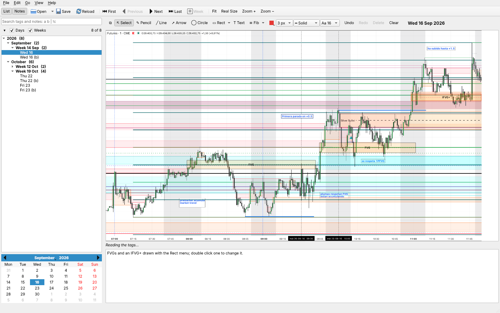
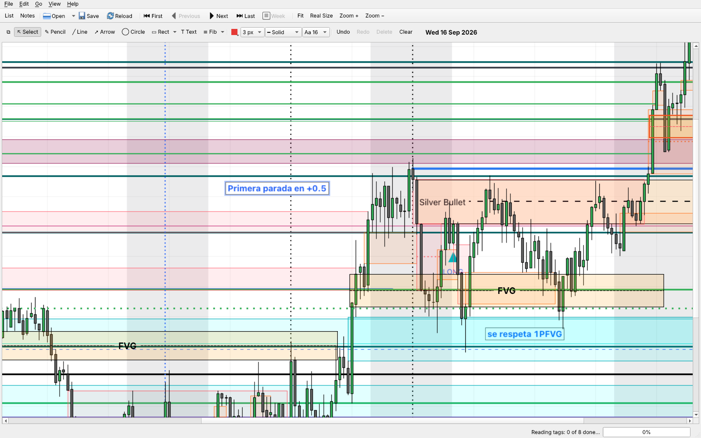

# DayJournal

Still in alpha. Just born for personal use. Provided AS-IS.

DayJournal browses a day journal: a directory with snapshots of day and
week charts. It reads the text written in each image with OCR and uses the
words as tags, so the images can be searched. Each image can have notes of
its own, kept in a `.txt` file next to it, and drawings on it. See the
[user manual](docs/MANUAL.md) and the [design notes](docs/DESIGN.md); there
are PDFs of both in `docs`.

What it does:

- Lists the captures by year, month and week (each group can be collapsed),
  with a calendar, and goes through them with the arrow keys.
- Searches the tags, the notes and the drawing labels, with `!` (not), `|`
  (or) and parentheses.
- Adds captures dropped on the window: it guesses their date from the dates
  written in them and the file's date, and names them; double click one in
  the list to change its date or make it a week profile. Right click one to
  cut or copy it and paste it in another journal, keeping its date.
- Draws on the captures: pencil, lines, arrows and circles with labels,
  rectangles with FVG, IFVG+, IFVG-, BRK and MB presets, Fibonacci levels
  (OTE, quadrants, PO3 or your own), and text, in solid, dashed or dotted
  lines, with undo. The drawing buttons can float in a bar of their own.
- Hides the list and the notes to give the chart the whole window, and
  zooms with a two finger double tap or a pinch.

Uses PySide6 Qt for widgets and easyocr for the OCR, the same tools as
[rb](https://github.com/fjballest/rb).

A day with two FVGs and an IFVG+ drawn from the Rect menu, and its notes:

The same day with the list and the notes hidden, zoomed on the FVGs:

## Running

    pip install -r requirements.txt
    python3 dj.py [journaldir]

Without a directory it opens the journal used last, or the first
`DayJournal*` directory found in `/u/trade` or `~/u/trade`.

## Building the app

    pyinstaller --noconfirm dj.spec

makes `dist/DayJournal.app` on macOS. The GitHub workflow
`.github/workflows/python-app.yml` builds it for Linux, Windows and macOS.

## The journal directory

| File | What it is |
|------|------------|
| `dayYYMMDD.png` | the chart of a day |
| `dayYYMMDDb.png` | another chart of the same day (any letter) |
| `dayYYMMDDweekprof.png` | a week profile: dated a Sunday, it is for the week starting the next day |
| `dayYYMMDD….txt` | the notes for the image with the same name |
| `dayYYMMDD….drw` | what is drawn on the image with the same name (JSON) |
| `.pyjou-tags.json` | the text read from each image, so OCR runs once per image |

## Source

| File | What it does |
|------|--------------|
| `dj.py` | starts the app; `dj.py --ocr` is the OCR process |
| `mainwin.py` | the main window: list, search, calendar, image, tags and notes |
| `journal.py` | the journal directory: images, notes, drawings, the tags cache, dates |
| `capture.py` | adding a capture: guessing its date and the dialog to confirm it |
| `tags.py` | turns OCR text into tags, dropping what isn't a word |
| `ocr.py` | easyocr, loaded on first use; `python3 ocr.py x.png` prints what it reads |
| `ocrworker.py` | runs the OCR in a separate process |
| `search.py` | search expressions |
| `viewer.py` | the image view: zoom, the drawing tools and their dialogs (shared with rb) |
| `drawing.py` | the shapes drawn, their undo commands and their JSON form (shared with rb) |
| `drawbar.py` | the drawing buttons, their menus and the floating bar (shared with rb) |

Tests: `QT_QPA_PLATFORM=offscreen python3 tests/test_journal.py`, and the
same for `test_drawing.py`, `test_capture.py` and `test_panels.py` (the OCR
is faked, so they run without easyocr).
