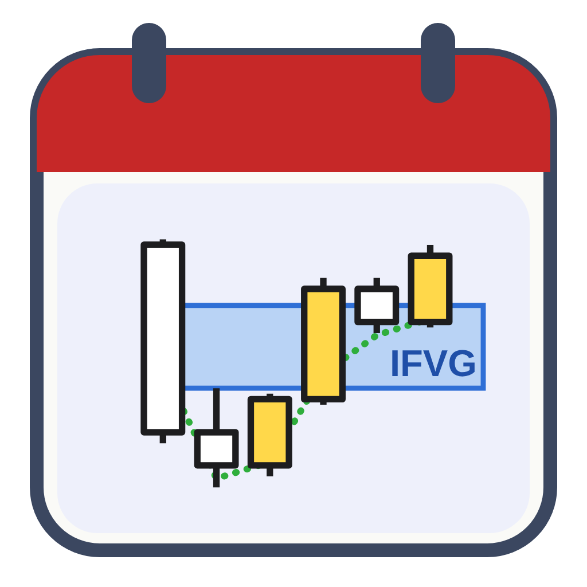
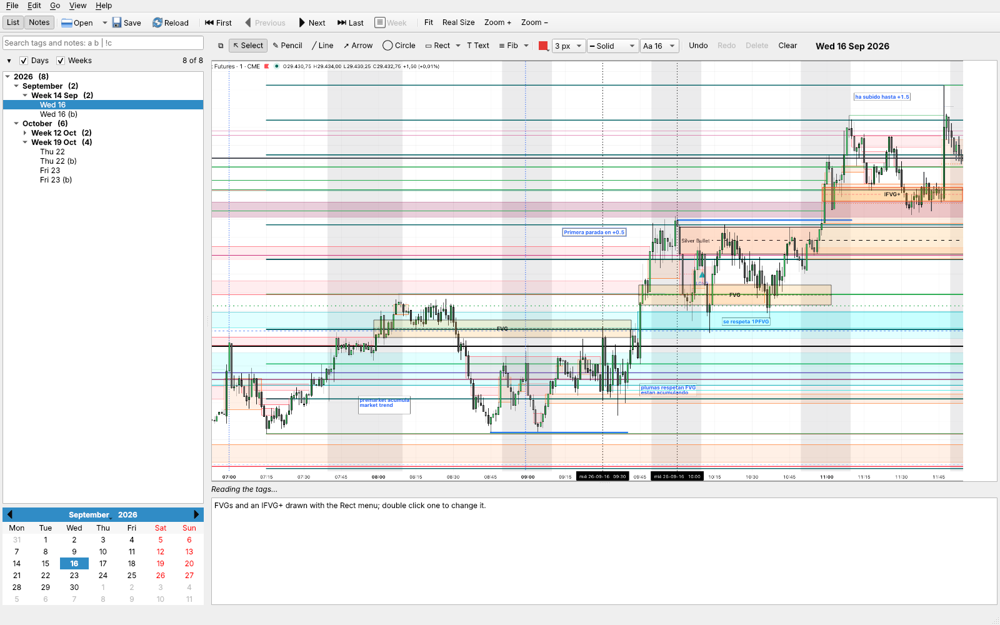
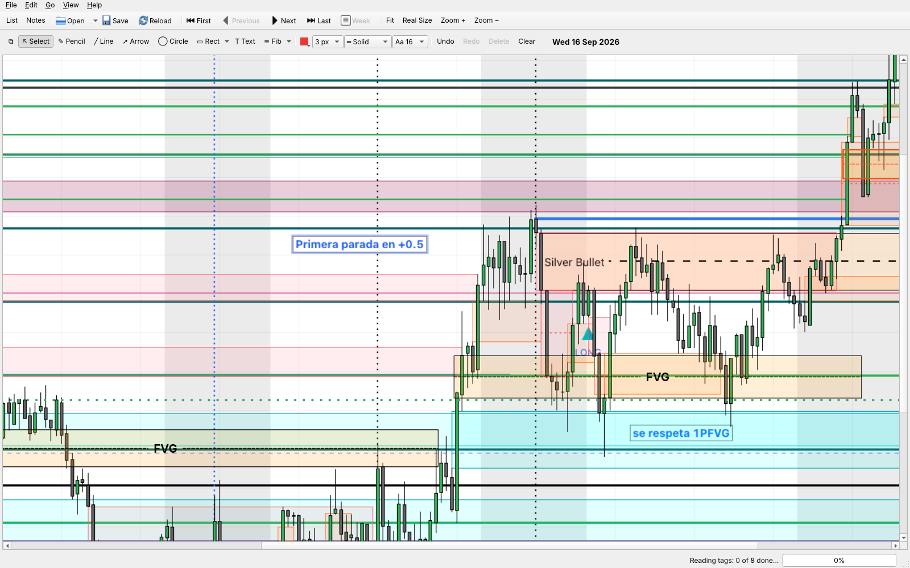
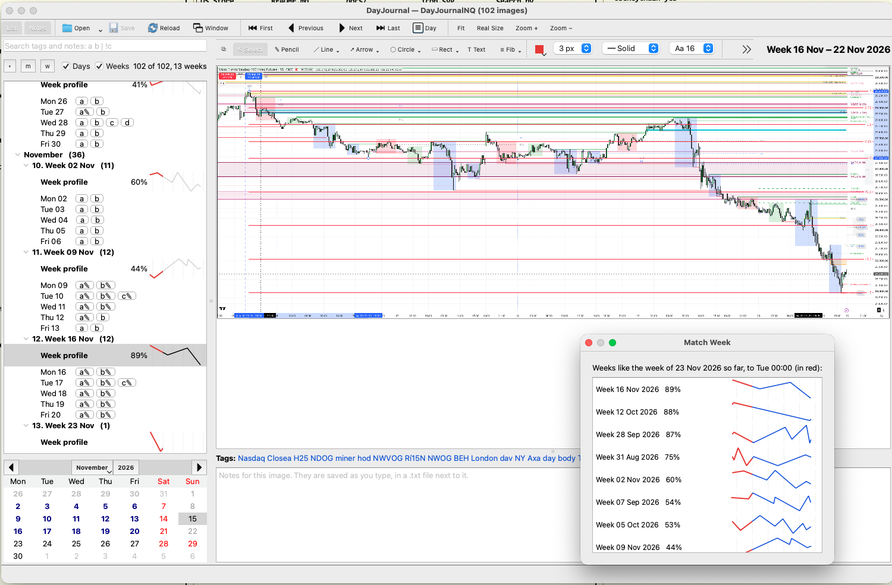
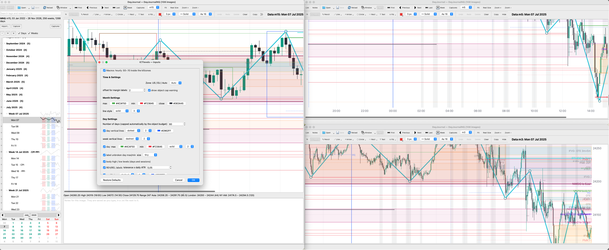
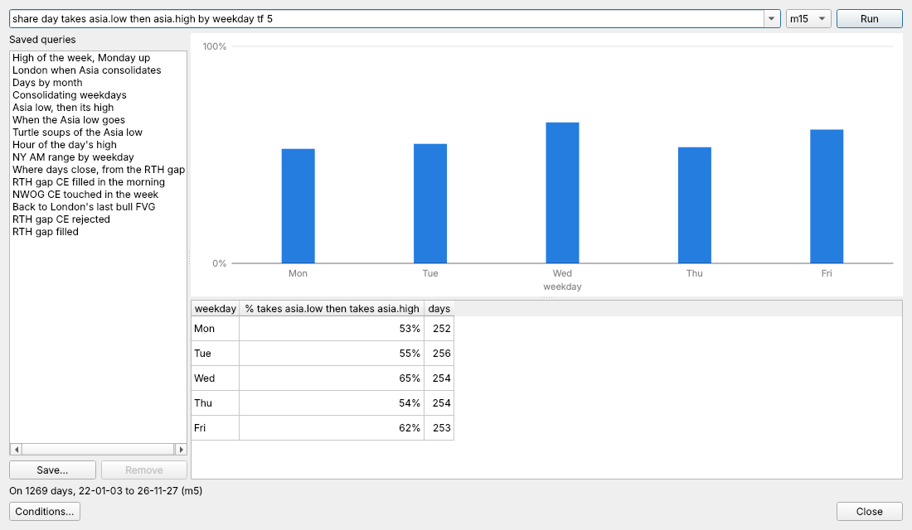

# DayJournal

Still in alpha. Just born for personal use. Provided AS-IS.

DayJournal is a trading journal for two kinds of material:

- **Captures**: snapshots of day and week charts, read with OCR so their
  text becomes tags to search, with notes and drawings of their own.
- **Data**: the market's candles, imported as CSV files exported from
  TradingView (m15, and m1, m3 or m5 for lower time frames). With them it
  draws charts of any day or week in time frames from m1 to monthly, runs
  Pine indicators and strategies on them, and answers questions about the
  data in a small query language that knows ICT levels and concepts:
  sessions and killzones, macros, the RTHOG, NDOG and NWOG opening gaps
  and their quadrants, FVGs with their volume imbalances, highs and lows
  taken, turtle soups, rejections and fills.

See the [user manual](docs/MANUAL.md) and the [design notes](docs/DESIGN.md);
there are PDFs of both in `docs`.

What it does with the data:

- **Charts** (View ▸ Data View): each week and day of the data, from its
  candles, in m1, m2, m3, m5, m15, m30, h1, h4, daily, weekly or monthly,
  with the Asia, London, NY AM and NY PM sessions, the week's profile, news
  days, and drawings kept per chart. More windows can show the same day in
  other time frames, synced.
- **Indicators and strategies**: Pine scripts imported from TradingView
  (ICTlevels, FVGs…) drawn on the charts, and the Strategy Tester, which
  runs a Pine strategy on the data and shows its trades on the charts.
- **Queries** (View ▸ Queries, or `?` in the search box): one line asks a
  question and gets a table and a chart, for example
  `share day takes asia.low then asia.high by weekday tf 5`,
  `dist (when week fills nwog).day`, `share nyam rejects rthog.ce`,
  `list day is consolidation`. Periods (years to hours, sessions, macros,
  any window of the day), their conditions (trend, reversal, consolidation,
  from what price did in them), levels and gaps, names for parts of
  queries, and lower time frames to find what came first to the minute.
- **Swing Times**: when swings and retracements tend to start, by time of
  day, hour of the week and day of the month.
- **RoadBook**: its Journal button shows the day of a trade here, at its
  entry and exit.

What it does with the captures:

- Lists the captures by year, month and week (each group can be collapsed),
  with a calendar, and goes through them with the arrow keys.
- Searches the tags, the notes and the drawing labels, with `!` (not), `|`
  (or) and parentheses, and with aliases kept in the journal's `aliases.txt`
  (`news: NFP, PPI, CPI` makes `news` find those too).
- Adds captures dropped on the window: it guesses their date from the dates
  written in them and the file's date, and names them; double click one in
  the list to change its date or make it a week profile. Right click one to
  cut or copy it and paste it in another journal, keeping its date, or to
  delete it (Del in the list). Drag one to a day of the calendar to move it there. A capture added can replace the ones of its day.
- Draws on the captures: pencil, lines, arrows and circles with labels,
  rectangles with FVG, IFVG+, IFVG-, BRK and MB presets, Fibonacci levels
  (OTE, quadrants, PO3 or your own), and text, in solid, dashed or dotted
  lines, with undo. The drawing buttons can float in a bar of their own. A
  crosshair cursor shows the same level across the chart.
- Hides the list and the notes to give the chart the whole window, and
  zooms with a two finger double tap or a pinch.
- Finds the profile of each week in its capture (the swings that frame it),
  draws it in the list, lets you adjust it on the capture, and matches a
  week in progress with the weeks that went the same way.
- Opens more windows (File ▸ New Window), on the same journal or another one,
  and lays them out from the Window menu: tiled, side by side, halves...

Uses PySide6 Qt for widgets and easyocr for the OCR, the same tools as
[rb](https://github.com/fjballest/rb).

A day with two FVGs and an IFVG+ drawn from the Rect menu, and its notes:

The same day with the list and the notes hidden, zoomed on the FVGs:

Edit ▸ Match Week on a week in progress (the week of 23 Nov, captured on
Tuesday): the weeks that went the same way, best first, and in the list the
profile of each week, the part matched in red:

The data view with the ICTlevels and FVGS+IFVG+OTE indicators on, the main
window in m15 with the inputs of ICTlevels, and synced windows in m5 and m3
on the same day:

View ▸ Queries on NQ data from 2022: the days that took the Asia low and
then its high, by weekday, found on m5 candles:

## Running

It needs Python 3.12 or later (the releases are built with 3.14) and
macOS 14 or later on a Mac. A virtual environment keeps its packages apart:

    python3.14 -m venv ~/u/trade/.venv
    ~/u/trade/.venv/bin/pip install -r requirements.txt
    ~/u/trade/.venv/bin/python dj.py [journaldir]

Without a directory it opens the journal used last, or the first
`DayJournal*` directory found in `/u/trade` or `~/u/trade`, or, when there is
no `u` directory, in `trade` in your documents directory or in the documents
directory itself (`~/Documents/trade/DayJournalDAX`, for example).

## Building the app

    pyinstaller --noconfirm dj.spec

makes `dist/DayJournal.app` on macOS. The GitHub workflow
`.github/workflows/python-app.yml` builds it for Linux, Windows and macOS.

## The journal directory

| File | What it is |
|------|------------|
| `dayYYMMDD.png` | the chart of a day |
| `dayYYMMDDb.png` | another chart of the same day (any letter) |
| `dayYYMMDDweekprof.png` | a week profile: dated a Sunday, it is for the week starting the next day |
| `dayYYMMDD….txt` | the notes for the image with the same name |
| `dayYYMMDD….drw` | what is drawn on the image with the same name (JSON) |
| `.pyjou-tags.json` | the text read from each image, so OCR runs once per image |
| `MNQ-YYMMDD.m15.csv.gz` | the m15 candles imported, by the day of their first one (`.m1.`, `.m5.`… for lower time frames) |
| `aliases.txt` | the aliases of words for searching |
| `conditions.txt` | the thresholds of the trend, reversal and consolidation conditions of queries |
| `queries.txt`, `definitions.txt` | the queries saved, and the names defined with `:=` |

## Source

| File | What it does |
|------|--------------|
| `dj.py` | starts the app; `dj.py --ocr` is the OCR process |
| `mainwin.py` | the main window: list, search, calendar, image, tags and notes |
| `journal.py` | the journal directory: images, notes, drawings, the tags cache, dates |
| `capture.py` | adding a capture: guessing its date and the dialog to confirm it |
| `tags.py` | turns OCR text into tags, dropping what isn't a word |
| `ocr.py` | easyocr, loaded on first use; `python3 ocr.py x.png` prints what it reads |
| `ocrworker.py` | runs the OCR in a separate process |
| `search.py` | search expressions |
| `viewer.py` | the image view: zoom, the drawing tools and their dialogs (shared with rb) |
| `drawing.py` | the shapes drawn, their undo commands and their JSON form (shared with rb) |
| `drawbar.py` | the drawing buttons, their menus and the floating bar (shared with rb) |
| `m15.py` | the candles of the journal: importing CSV files, time frames, sessions, New York time |
| `dataview.py` | the data view: the list of weeks and days and their charts |
| `indicators.py`, `pine/` | Pine indicators on the charts: a Pine interpreter and its drawings |
| `backtest.py` | the Strategy Tester |
| `patterns.py` | Swing Times |
| `query.py`, `querywin.py` | the query language and its window; `python3 query.py journal 'query'` from a terminal |
| `link.py` | what RoadBook asks DayJournal to show |
| `weekprof.py`, `weekedit.py` | the week profiles found in captures, and adjusting them |
| `news.py` | the days with US news (FOMC, CPI, PPI, NFP) |

Tests: `for t in tests/test_*.py; do QT_QPA_PLATFORM=offscreen python3 $t; done`
(the OCR is faked, so they run without easyocr).
